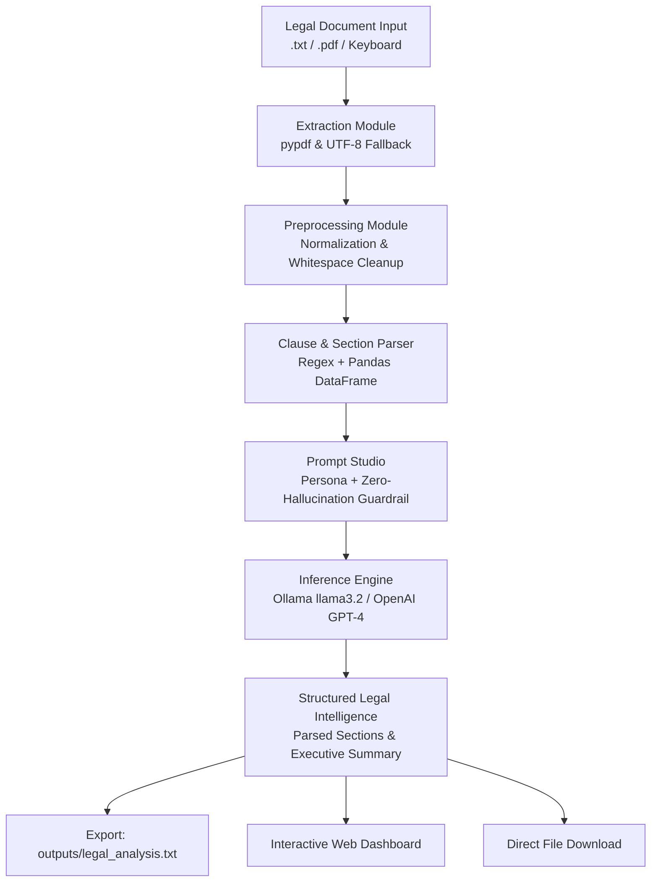

# JurisAI — Automated Legal Document Analyzer

[](https://www.python.org/)
[-orange?logo=ollama&logoColor=white)](https://ollama.com/)
[](https://pandas.pydata.org/)
[](#prompt-engineering--guardrails)
[](#key-features)
[](#academic-context)

> **Automated Legal Document Analyzer using GPT-4 / Ollama**: An enterprise-grade legal analytics platform that ingests legal contracts (NDAs, Employment Agreements, Service Agreements), normalizes text, parses clauses into structured Pandas dataframes, constructs zero-hallucination prompts, and generates executive summaries and structured intelligence reports using local LLMs.

---

## Table of Contents
- [Overview](#overview)
- [Key Features](#key-features)
- [System Architecture](#system-architecture)
- [Visual Workflow & Screenshots](#visual-workflow--screenshots)
- [Project Structure](#project-structure)
- [Installation & Setup](#installation--setup)
- [Running the Application](#running-the-application)
- [Sample Generated Analysis](#sample-generated-analysis)
- [Academic Context](#academic-context)

---

## Overview

Legal agreements are notoriously dense, featuring formal jargon, cross-references, and layered conditions. Manually reviewing contracts for critical obligations, termination notice periods, and financial liabilities is time-consuming and error-prone.

**JurisAI** solves this by providing an end-to-end automated pipeline:
1. **Multi-Format Ingestion**: Ingests contracts via PDF stream, UTF-8 plain text, or direct keyboard paste.
2. **Document Normalization**: Strips unprintable artifacts, normalizes smart quotes and whitespace, and segments clauses.
3. **Structured Clause Parsing**: Uses regex and **Pandas** to extract and categorize contract articles and word counts into an interactive table.
4. **Zero-Hallucination Prompting**: Strictly constrains the LLM to facts explicitly present in the document (*"Do not invent information. If information is not available, state 'Not mentioned in the document.'*").
5. **On-Premise LLM Inference**: Runs locally via **Ollama** (`llama3.2` / `qwen2.5`) with zero API costs, zero internet dependency, and zero risk of proprietary data leakage, while maintaining seamless compatibility with cloud **OpenAI GPT-4**.
6. **Automated Export**: Saves structured reports directly to `outputs/legal_analysis.txt` and provides one-click browser downloads.

---

## Key Features

- **100% Offline & Free by Default**: Powered by local Ollama (`llama3.2` 3B parameter model). No API keys or paid credits required.
- **Strict Anti-Hallucination Policy**: Enforces strict grounding in contract terms to guarantee deterministic extraction of dates, dollar figures, and parties.
- **Pandas Clause Analytics**: Automatically compiles contract sections, character distributions, and preview snippets into structured data tables.
- **Dual Interface**:
  - **Modern Web Dashboard**: Glassmorphic dark UI built with HTML5, Vanilla CSS, and JavaScript.
  - **Interactive Terminal CLI**: Standardized 7-option console loop for headless and server environments.
  - **Batch CLI Command**: Instant one-line terminal analysis (`python main.py --file <path>`).
- **Comprehensive Legal Extraction**:
  - Document Classification & Type
  - Identified Parties & Roles
  - Scope & Commercial Purpose
  - Term Duration & Survival Clauses
  - Key Obligations & Responsibilities
  - Payment Terms & Consideration
  - Termination Notice Periods & Conditions
  - Effective Dates & Milestone Deadlines
  - Potentially Critical Clauses
  - Executive Abstract

---

## System Architecture



---

## Visual Workflow & Screenshots

The platform provides a complete visual pipeline matching each stage of the document analysis workflow:

### 1. Home Screen (Dashboard Overview)
*High-level contract metrics, active model status pill, and pipeline stage cards.*


---

### 2. Legal Document Input
*Preset sample contract loader (NDA, Employment, Service Agreement) and custom contract text editor with live word and character counters.*


---

### 3. Document Text Extraction
*Detailed metadata strip (character count, word count, estimated reading pages) and raw document stream preview.*


---

### 4. Preprocessed Text & Clause Breakdown
*Cleaning reduction metrics and structured clause detection table powered by Pandas.*


---

### 5. Prompt Generation & Guardrails
*System role configuration and zero-hallucination constraint inspection.*


---

### 6. GPT-4 / Ollama LLM Response
*In-flight inference tracking and raw generation output drawer.*


---

### 7. Legal Document Summary & Intelligence Cards
*Executive summary banner and structured cards for parties, obligations, payments, and termination.*


---

## Project Structure

```text
Ex5/
├── .env                                 # Local configuration (Ollama host, model name)
├── .env.example                         # Example configuration template for repository
├── .gitignore                           # Git ignore rules for bytecode, secrets, and environments
├── requirements.txt                     # Project dependencies
├── README.md                            # Comprehensive project documentation
├── main.py                              # Core application controller (CLI + Web Server)
│
├── frontend/                            # Modern Web Dashboard
│   ├── index.html                       # Semantic HTML5 layout
│   ├── style.css                        # Glassmorphism dark theme styling
│   └── app.js                           # State manager, REST API client, dynamic renderer
│
├── modules/                             # Core Python Backend Modules
│   ├── __init__.py                      # Package exports
│   ├── input_module.py                  # Document ingestion & terminal card display (Part A)
│   ├── extraction_module.py             # PDF & plain text extraction engine (Part A)
│   ├── preprocessing_module.py          # Cleaning, chunking, and Pandas clause parsing (Part B)
│   ├── prompt_module.py                 # Structured prompt builder with guardrails (Part C)
│   └── summary_module.py                # LLM client (Ollama/OpenAI) and report exporter (Part D & E)
│
├── sample_contracts/                    # Verified Test Legal Documents
│   ├── sample_nda.txt                   # Mutual Non-Disclosure Agreement
│   ├── employment_contract.txt          # Senior ML Engineer Employment Contract
│   └── service_agreement.txt            # Master Cloud Migration Services Agreement
│
├── outputs/                             # Export Directory
│   └── legal_analysis.txt               # Automated generated legal intelligence report
│
└── screenshots/                         # Captured pipeline screenshots
    ├── Home Screen.png
    ├── Legal Document Input.png
    ├── Document Text Extraction.png
    ├── Preprocessed Text.png
    ├── Prompt Generation.png
    ├── GPT-4 Response.png
    └── Legal Document Summary.png
```

---

## Installation & Setup

### 1. Clone the Repository
```bash
git clone https://github.com/<your-username>/automated-legal-document-analyzer.git
cd automated-legal-document-analyzer
```

### 2. Verify / Install Dependencies
Python 3.10+ is recommended. Install required packages using `requirements.txt`:
```bash
pip install -r requirements.txt
```

### 3. Start Local Ollama Server
Ensure Ollama is installed and the `llama3.2` model is downloaded:
```bash
# Check if Ollama is running
ollama list

# If llama3.2 is not downloaded yet:
ollama pull llama3.2
```

### 4. Environment Configuration
Copy `.env.example` to `.env` (already configured for local Ollama by default):
```ini
LLM_PROVIDER=ollama
OLLAMA_HOST=http://localhost:11434
OLLAMA_MODEL=llama3.2

# Optional: Only needed if switching to cloud OpenAI
OPENAI_API_KEY=
OPENAI_MODEL=gpt-4o-mini
```

---

## Running the Application

### Option A: Launch Web Dashboard (Recommended)
Launch the modern browser interface on port 8080:
```bash
python main.py --web
```
Navigate to: **[http://localhost:8080](http://localhost:8080)**

### Option B: Interactive Terminal CLI
Run the interactive menu in PowerShell or Command Prompt:
```bash
python main.py
```
```text
======================================================================
  AUTOMATED LEGAL DOCUMENT ANALYZER (Experiment 5 - 24CS2506)
  Powered by Local LLM (Ollama) & Advanced Document Processing
======================================================================
----------------------------------------------------------------------
 Current Document : No document loaded
 Analysis Status  : Not performed
----------------------------------------------------------------------
 APPLICATION MENU (Part F - Q7):
  [1] Upload / Enter Legal Document (Part A - Q1 & Q2)
  [2] Analyze Document & Extract Sections (Part B - Q3)
  [3] Generate Summary & Legal Analysis (Part C & D - Q4 & Q5)
  [4] Save Report to File (Part E - Q6)
  [5] Launch Modern Web UI in Browser
  [6] Reset Application State
  [7] Exit Application
----------------------------------------------------------------------
 Select an option (1-7):
```

### Option C: Direct Batch Analysis
Analyze a specific legal contract directly from the command line:
```bash
python main.py --file "sample_contracts/sample_nda.txt"
```

---

## Sample Generated Analysis

Below is an extract of the automated analysis generated by the engine for `sample_contracts/sample_nda.txt` (stored at `outputs/legal_analysis.txt`):

```text
LEGAL DOCUMENT ANALYSIS REPORT
Generated via: Ollama (llama3.2)
Execution Time: 22.9 seconds
============================================================

LEGAL DOCUMENT ANALYSIS
--------------------------------

Document Type:
Non-Disclosure Agreement

Parties:
- Disclosing Party: Apex Cloud Technologies Inc.
- Recipient: Quantum Systems Private Limited

Purpose:
The Discloser and Recipient wish to explore a potential business partnership regarding the collaborative development and integration of AI-driven enterprise document processing solutions.

Duration:
- Term: Twelve (12) months from the Effective Date
- Survival clause: Confidentiality obligations regarding trade secrets and proprietary algorithms shall survive expiration or termination for an additional period of three (3) years from the date of disclosure.

Key Obligations:
• The Recipient shall hold and maintain the Confidential Information in strict confidence, exercising at least the same degree of care as it uses to protect its own confidential information of like nature, but no less than a reasonable degree of care.
• The Recipient shall restrict disclosure of Confidential Information solely to its employees, officers, and legal advisors who have a strict need to know for the Authorized Purpose and who are bound by confidentiality obligations at least as restrictive as those herein.
• The Recipient agrees not to use Discloser's Confidential Information for any purpose other than the Authorized Purpose without prior written consent.

Payment Terms:
No monetary payments or consulting fees are due under this Agreement.

Termination Conditions:
- Either party may terminate this Agreement at any time with thirty (30) days prior written notice to the other party.
- Upon termination or written request by Discloser, Recipient shall immediately return or securely destroy all tangible and electronic copies of Confidential Information and provide written certification of such destruction within ten (10) business days.

Important Dates:
• Effective / Start Date: October 1, 2026
• Expiration / Milestone Dates: None mentioned
• Notice Periods / Deadlines: Thirty (30) days prior written notice for termination

Potentially Important Clauses:
• Exclusions from Confidentiality: This clause outlines the exceptions to the confidentiality obligations, including information that is publicly known, already in the rightful possession of the Recipient, independently developed, or rightfully received from a third party.
• Term and Duration: This clause specifies the duration of the Agreement and the survival of confidentiality obligations regarding trade secrets and proprietary algorithms.
• Payment and Consideration: This clause acknowledges the mutual exchange of proprietary discussions and consideration of business integration as sufficient legal consideration.

Summary:
This Non-Disclosure and Confidentiality Agreement outlines the terms and conditions for the collaboration between Apex Cloud Technologies Inc. and Quantum Systems Private Limited regarding the development and integration of AI-driven enterprise document processing solutions. The Agreement establishes confidentiality obligations, specifies the duration and termination conditions, and provides for the exchange of proprietary discussions and consideration as sufficient legal consideration.

============================================================
Report generated automatically by Automated Legal Document Analyzer.
```

---

## Academic Context

- **Course Code**: 24CS2506
- **Course Title**: Building Applications using GPT-4
- **Experiment 5**: Automated Legal Document Analyzer using GPT-4
- **Curriculum Objective**: Design and implement a structured NLP and LLM processing pipeline that extracts contract parameters, cleans text, constructs zero-hallucination prompts, generates abstractive summaries, and persists legal intelligence reports.

---

## License

This project is open-source and available under the [MIT License](LICENSE).
